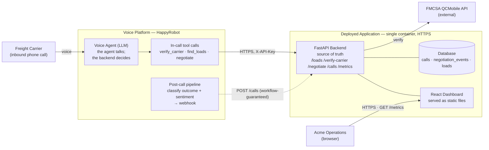

# Inbound Carrier Sales Agent — Build and Deployment Document

**Prepared for Acme Logistics**

An AI voice agent that answers inbound carrier calls, verifies the carrier, matches a load, negotiates the rate within set limits, books the load, and reports every call.

---

## 1. Executive summary

Carrier sales reps spend a large share of their day on repetitive inbound calls: a carrier sees a load on a board, calls in, gives their MC number, asks about the load, and haggles over the rate. This system handles that call end to end, automatically, around the clock.

In one inbound call the agent:

- Verifies the carrier is allowed to operate, checked live against the federal FMCSA registry.
- Looks up the load the carrier is asking about and reads back the details.
- Negotiates the rate inside limits you control, with every number decided by software, not guessed by the model.
- Books the load and records the outcome, the agreed rate, the caller sentiment, and the negotiation history.

Every call, booked or not, is written to an analytics dashboard built for broker operations: booking rate, after-hours coverage, rep-hours freed, margin captured against the ceiling, and per-call drill-down. The result is a system that extends your desk past business hours, holds the line on margin consistently, and gives you a live view of what is happening on every carrier call.

---

## 2. Why adopt this

For a freight broker, inbound carrier calls are constant. A busy desk fields hundreds of them a day, each one a carrier who saw a load and wants to talk rate, and hiring enough people to answer all of them is harder every year. Every call that rings out, waits on hold, or lands after hours is a load that may go uncovered. This system is built to take those calls directly, as an always-on member of the desk, so the work gets done and your reps are freed for the parts that need a person.

### What it changes in operations today

- **Every call answered, around the clock.** The agent picks up immediately, after hours and during surges, with no hold time. Calls that would have gone to voicemail or rung out become booked loads.
- **Consistent margin discipline.** Every rate is computed against a set ceiling, the same on the first call of the day and the five hundredth. The discipline does not slip with fatigue or vary from one rep to the next.
- **Reps freed for the work that needs them.** The agent handles the repetitive verify, look up, and haggle call, so your people spend their time on carrier relationships, problem loads, and the calls where judgment matters.
- **A live view of every call.** Outcome, rate against the posted rate, negotiation rounds, and caller sentiment are captured on every call, an operational picture you cannot get from reps' recollection.

### What it sets up for scale

- **Absorbs volume without adding headcount.** The backend is stateless and deterministic, designed to scale horizontally, so a surge in inbound calls becomes a capacity setting rather than a hiring problem.
- **A defined escalation path.** The call flow has explicit handoff points for cases that should reach a person. Connecting them to a live human transfer is a configuration step on top of what exists today.
- **Sentiment as an early signal.** Beyond a dashboard number, repeated negative sentiment on a lane or a rate is a flag worth a person's attention, and can drive alerts or routing as the system grows.
- **Data that compounds.** Every call becomes structured data, the foundation for sharpening pricing, objection handling, and lane strategy over time, so each month of use informs the next.

This starts with one high-volume, high-value call type, inbound carrier sales, and is built to extend across the rest of the desk from there.

---

## 3. How a call works

A typical inbound call runs through five steps. Each is a route through one flow, not a separate script.

- **Greeting.** The agent answers as Acme Logistics and asks for the load reference number the carrier saw on the board.
- **Carrier verification.** The agent takes the carrier's MC number and checks it against the FMCSA registry. A carrier not authorized to operate is declined politely and the call is logged.
- **Load lookup.** The agent pulls the load by its reference and reads back the lane, equipment, pickup and delivery, and any special notes. An unmatched reference is handled honestly rather than guessed.
- **Negotiation.** When the carrier names a rate, the software decides whether to accept, counter, or hold firm at the maximum. This is the heart of the system and is detailed in section 5.
- **Close.** On agreement the agent confirms the rate and hands the call off. Every call is then classified and written to the dashboard.

---

## 4. System architecture

The voice conversation runs on the HappyRobot platform. This build provides everything behind it: the backend API that holds the data and makes every decision, the analytics dashboard, and the deployment.



The guiding principle is one line: **the agent talks, but the backend decides anything involving money or a booking.** Round counts, the price ceiling, every offer, and the booked rate are all computed server-side and keyed to the platform's call identifier. The agent only ever passes the call id, the load, and the carrier's stated number; it never invents a price or counts a round. That separation is what keeps rates predictable and every outcome auditable.

### Components

| Component | Responsibility |
|-----------|----------------|
| Voice agent (HappyRobot) | Runs the conversation, calls the backend tools, and triggers the post-call pipeline. Lives on the HappyRobot platform, not in this build. |
| Backend API (FastAPI) | The source of truth. Serves loads, verifies carriers, runs the negotiation engine, records calls, and produces the dashboard metrics. |
| Dashboard (React) | A single-page analytics view, served by the backend, that reads the metrics endpoint. |
| Database | Holds loads, call records, and negotiation history. SQLite in this build; a managed database in production. |
| FMCSA QCMobile API | External federal registry used to verify carrier authority. |

---

## 5. The negotiation engine

Rate negotiation is handled entirely by software, never by the language model. Letting a model decide how much to concede is letting it make a money decision on a hunch, which is exactly where automated agents drift. Instead, every number the agent says is computed by code against rules you set, so each concession is explainable and the maximum is never at risk.

### The ceiling

Each load carries a maximum the agent may reach, set as a margin over the posted rate and scaled by urgency. Loads picking up soonest get the most room; loads further out get less. The ceiling is a hard cap enforced independently of everything else.

| Days to pickup | Ceiling over posted rate |
|----------------|--------------------------|
| 2 days or less | up to 8 percent |
| 3 to 5 days | up to 6 percent |
| more than 5 days | up to 4 percent |

These tiers stay within the real-world ceiling of roughly 10 percent over the posted rate, beyond which a broker's own margin disappears.

### The concession pattern

Real brokers concede the most on the first counter and taper after that. A big first move followed by smaller ones signals that the broker is near their limit, which closes faster and discourages further pushing. The agent follows that front-loaded pattern across up to three rounds, with offers rounded to clean freight numbers so they sound natural on the call.

### Two safeguards added after live testing

Real test calls were placed into the system, and two behaviors were corrected before this submission:

- **A carrier who misspeaks.** If a carrier states a number below the posted rate, almost always a slip or a dropped digit, the agent no longer takes it. It asks the carrier to restate the rate, without revealing the floor, then continues. A mis-heard number can no longer book a load far under value.
- **Locking in the agreed number.** When a carrier accepts the agent's counter, the system records the exact agreed rate as the booked rate, computed server-side, never whatever was last spoken. The booked figure on the dashboard is always the number both sides agreed to.

---

## 6. The analytics dashboard

Every call writes a structured record, and the dashboard turns those records into a control-tower view, built to be read top to bottom from the numbers a manager needs first down to per-call detail. It reports:

- Calls handled, booking rate, and after-hours calls, when no human would have answered.
- Rep-hours freed, the measured time the automation took off the team, with a projected annual figure shown as a clearly labeled estimate.
- Outcome breakdown across the seven call outcomes, ranked, with the biggest drop-off highlighted.
- Realized margin versus ceiling by urgency tier, how much room over the posted rate was actually captured against the maximum available.
- Negotiation effectiveness: average rounds to close and how deals settled across rounds.
- Caller sentiment, split by booked and not-booked, with an honest note that it covers the agent's calls only and is not a comparison against human reps.
- A recent-calls table for per-call drill-down.

The dashboard reads its data once on load. A live call appears in the recent-calls list on the next refresh, which makes it easy to demonstrate the end-to-end pipeline.

---

## 7. Technical implementation

### Stack

| Layer | Technology |
|-------|------------|
| Backend | Python, FastAPI, async SQLAlchemy over SQLite (aiosqlite) |
| Frontend | React (Vite single-page app), served by the backend as static files |
| Carrier verification | FMCSA QCMobile API |
| Authentication | API key in the `X-API-Key` header on every endpoint |
| Container | Docker, multi-stage build (frontend built, then served by the backend) |
| Deployment | Railway, HTTPS |
| Voice agent | HappyRobot platform (outside this repository) |

### API endpoints

Every endpoint requires the `X-API-Key` header; an invalid key returns `401`.

| Endpoint | Purpose |
|----------|---------|
| `GET /loads` | List loads, with optional equipment, origin, and destination filters. |
| `GET /loads/{id}` | Fetch a single load by reference. `404` if not found. |
| `GET /verify-carrier/{mc}` | FMCSA authority check. Returns eligibility and carrier name. Not found returns `200` with eligible false; FMCSA failure returns `502`. |
| `POST /negotiate` | The pricing engine. Input: call id, load, carrier offer. Returns accept, counter, final, or confirm. Server derives the round, ceiling, and offer. |
| `POST /calls` | Upserts a call record from the post-call webhook, keyed by call id. The dashboard's data source. |
| `GET /metrics` | Single-payload aggregate the dashboard renders. |

A full request and response contract for every endpoint is in `docs/API_CONTRACT.md`.

### Data model

Two tables, keyed by the HappyRobot run identifier (the call id):

- **`calls`** — one row per call, upserted as the call progresses. Holds carrier, load, outcome, outcome source, sentiment, booked rate, derived round count, duration, and the run URL.
- **`negotiation_events`** — one row per negotiation round, written by the negotiate endpoint, holding the carrier offer, the agent price, and the decision.

The post-call webhook upserts the call row at the end of every call; the negotiate endpoint writes the booked rate on accept and may create the call row first. Outcome trust is explicit: a deterministically resolved outcome always wins over a post-call classifier label.

---

## 8. Setup and configuration

A reviewer can stand the system up locally with the steps below. The backend and the dashboard each read a small set of environment variables, documented in full.

### Prerequisites

- Python 3.11 or newer
- Node 18 or newer
- A free FMCSA QCMobile API key (from the FMCSA developer portal)

### Environment variables

**Backend (`backend/.env`)**

| Variable | Required | Description |
|----------|----------|-------------|
| `LOADS_API_KEY` | Yes | The API key that gates every backend endpoint. Callers send it in the `X-API-Key` header. Generate one with `python -c "import secrets; print(secrets.token_urlsafe(32))"`. |
| `FMCSA_API_KEY` | Yes | FMCSA QCMobile web key used for the carrier authority lookup. Server-side only; never sent to the browser. |
| `DATABASE_URL` | No | SQLite path. Defaults to `sqlite+aiosqlite:///./carrier_sales.db`. Override to point at a different database. |

**Frontend (`frontend/.env`)**

| Variable | Required | Description |
|----------|----------|-------------|
| `VITE_API_KEY` | Yes | The key the dashboard sends with its API calls. Must match `LOADS_API_KEY`. |
| `VITE_API_BASE` | No | Base URL of the API. Leave empty when the backend serves the dashboard on the same origin (the production build). Set to `http://localhost:8000` only when running the Vite dev server separately. |

> Note on the frontend key: because the dashboard runs in the browser, `VITE_API_KEY` is compiled into the built files and is therefore visible to anyone who opens the deployed dashboard. In this build that exposes read access to synthetic demo data only. The production remedy is covered in section 10.

### Run it locally

**Backend**

```bash
cd backend
python -m venv .venv && source .venv/bin/activate
pip install -r requirements.txt
uvicorn app.main:app --reload --port 8000
```

On first start the server creates the database, seeds 10 loads and 46 synthetic call records (56 seed rows across the two tables), and begins serving at `http://localhost:8000`. The synthetic calls are prefixed `seed-` so the seed is idempotent: startup skips it entirely if any seed row already exists.

**Frontend (development, hot reload)**

```bash
cd frontend
npm install
# set VITE_API_KEY in frontend/.env to match LOADS_API_KEY
npm run dev   # dashboard at http://localhost:5173
```

**Production build (single origin)**

```bash
cd frontend && npm install && npm run build && cd ..
cd backend && uvicorn app.main:app --port 8000
# dashboard at http://localhost:8000, API at http://localhost:8000/metrics
```

**Tests**

```bash
cd backend && python -m pytest tests/ -q
```

The suite covers authentication, loads, carrier verification, call ingestion, the negotiation ladder including the below-rate floor and the ceiling clamp, and the metrics aggregation.

---

## 9. Infrastructure and deployment

The application is intentionally light: one stateless container that serves both the API and the dashboard. It can run on any host that accepts a Docker image and provides HTTPS.

### What the deployment needs

| Requirement | Detail |
|-------------|--------|
| Container host | Any platform that runs a Docker image and provides HTTPS. This build uses Railway; Fly.io, Render, or a managed container service such as GCP Cloud Run are equivalent. |
| Compute | Minimal. The image is roughly 70 MB and the workload is light; about 0.5 to 1 vCPU and 512 MB to 1 GB of memory is comfortable for the demo. |
| TLS / HTTPS | Required, since the voice platform and the browser call the API over HTTPS. Railway provides a certificate automatically. |
| Outbound network | The backend must reach the FMCSA QCMobile API over HTTPS for carrier verification. |
| Environment variables | `LOADS_API_KEY`, `FMCSA_API_KEY`, and the frontend `VITE_API_KEY` set on the host. See section 8. |
| Persistent storage | Optional in the POC (SQLite reseeds on restart). Production would attach a persistent volume or, preferably, a managed database (see section 10). |
| HappyRobot workspace | The voice workflow, with its API base variable pointed at the deployed backend URL and re-published. |

### Build and deploy

The multi-stage Dockerfile builds the dashboard, then the backend serves the API and the built dashboard from a single image:

```bash
docker build -t inbound-carrier-sales .
docker run -p 8000:8000 --env-file .env inbound-carrier-sales
```

On the host, set the three environment variables, deploy the image, and take the HTTPS URL the platform issues. Then point the HappyRobot workflow's API base variable at that URL and re-publish, so the voice agent calls the deployed backend rather than a local tunnel.

---

## 10. Design decisions and honest limits

This is a proof of concept built to prove the core flow end to end, not a finished production system. Several capabilities were deliberately kept simple. Each is called out here, because knowing where the edges are is part of trusting the system.

**Pricing inputs.** The true ceiling on a rate is what the shipper pays minus your target margin, which a broker knows before the call. That figure is not in the load data provided, so the ceiling here is derived from the posted rate. In production the system reads the shipper rate and margin target from your TMS; the negotiation logic does not change, only the input that feeds the ceiling.

**One load per call.** The system assumes a carrier is calling about one specific load, which is how the large majority of inbound calls go. If a carrier raised a second load on the same call, the per-load negotiation history is still kept correctly, but the call summary reflects the last load handled. Supporting several loads per call is a straightforward data-model change.

**Carrier vetting.** Eligibility is a clean pass or fail against FMCSA authority. A production policy would weigh safety rating, insurance on file, and authority history against thresholds you set; that richer check is a configuration layer over the same lookup.

**No invented incentives.** When a carrier rejects the final rate, the agent makes an honest case from the load's real strengths and then walks away professionally, keeping the carrier on file. It never offers quick pay, detention coverage, lumper advances, or reload guarantees. Those are real financial commitments the agent has no authority to make without explicit per-load policy. Letting an agent invent perks to close is worse than losing the load, so it is forbidden; in production these levers are switched on per load through a policy the agent reads.

**Security.** Every endpoint is protected by an API key and served over HTTPS, which meets the security bar for this build. The one honest limitation is that the dashboard, running in the browser, carries its API key in the built files, so it is visible to anyone who opens the deployed dashboard. Here that exposes synthetic demo data only. The production fix is to authenticate the user viewing the dashboard, or to inject the data server-side, so no key ever reaches the browser.

**Data persistence.** The demo uses SQLite, which reseeds its sample data on restart. Production would use a persistent, managed database, and call and load data would sync from your real load board and TMS rather than from seed data.

---

## 11. What a production version adds

The build is structured so the path to production is additive, not a rewrite. The highest-value next steps, grouped by area:

**Negotiation engine**
- Source the ceiling from the shipper-paid rate and margin target via the TMS.
- Layer market-rate and lane-density signals into pricing, so the agent holds firmer on busy lanes and flexes on quiet ones.
- Add policy-gated incentives (quick pay, detention, reload) under strict, authorized per-load limits.

**Call flow**
- Add a second path for carriers offering an empty truck on a lane, alongside the load-reference path that exists today; both lookups are already built.
- When a requested load is already covered, pivot the carrier to similar loads on the same lane instead of dead-ending.

**Platform and data**
- Move to a persistent managed database and sync loads from the real load board and TMS.
- Richer FMCSA vetting (safety rating, insurance, authority history) against a configurable policy.

**Security**
- Replace the browser API key with session-based user authentication, or server-inject the dashboard data, so no key is exposed client-side.

---

*The live dashboard, the code repository, and the HappyRobot workflow are provided alongside this document. A full register of design decisions and future-work items accompanies the repository in `docs/DECISIONS.md`.*
